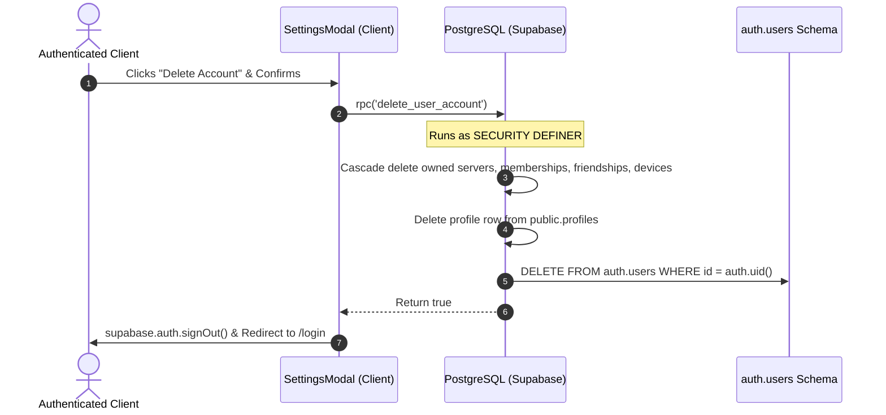

# System Architecture Documentation

## 1. Authentication & Account Deletion Lifecycle

### Account Deletion
Account deletion is triggered from `SettingsModal` (`src/components/layout/settings-modal.tsx`) via the database RPC `delete_user_account()`.

### Architectural Notes on `auth.users` Deletion
- **Direct Database Execution**: The `delete_user_account()` function runs as `SECURITY DEFINER` (database superuser/postgres role), allowing it to delete the row directly from the PostgreSQL `auth.users` table along with all associated public tables in an atomic transaction.
- **Client Limitation**: Browser clients using anon/publishable keys cannot directly delete or alter rows in `auth.users` via standard Supabase client SDK calls (`supabase.auth.admin.deleteUser(...)` requires the `SUPABASE_SERVICE_ROLE_KEY`).
- **External GoTrue Sync**: If Supabase Auth is hosted in a decoupled multi-region GoTrue deployment with independent cache layers, a server route utilizing the `SUPABASE_SERVICE_ROLE_KEY` can be used to invoke `supabase.auth.admin.deleteUser(id)` to flush any external session caches.

---

## 2. Realtime Channels & Realtime Authorization (GA)

### Architecture
All client realtime subscriptions are routed through `RealtimeHub` (`src/lib/realtime/realtime-hub.ts`) to manage reference counts and avoid redundant WebSocket connections.

Every channel transmitting private data specifies `config: { private: true }`. Supabase Realtime Authorization validates topics against Row Level Security policies on `realtime.messages` using `public.realtime_topic_authorized(topic, auth.uid())`:

| Topic Format | Authorized Roles / Conditions |
|---|---|
| `conv:<id>:chat`, `conv:<id>:call` | Verified via `public.is_conversation_member(id, auth.uid())` |
| `user:<id>:signals`, `user_notifications_<id>` | Verified via `auth.uid() = id` |
| `server:<id>:voice` | Verified via `public.is_server_member(id, auth.uid())` |
| `channel:<id>:chat`, `voice_room_<id>` | Verified via `public.is_channel_server_member(id, auth.uid())` |
| `anon` role | Revoked / Blocked on all realtime messages |

---

## 3. Rate Limiting Architecture

The `/api/calls/token` route enforces a sliding-window rate limit (30 requests / minute) using an in-memory `Map`.

### Serverless & Multi-Instance Considerations
- In serverless runtimes (Next.js lambda functions / Vercel), in-memory rate limiting operates per-instance and does not synchronize state across horizontally scaled instances.
- It provides defense-in-depth against runaway client retry loops on the same warm instance.
- For strictly bounded rate limiting across multiple instances, production deployments should employ:
  - Upstash Redis (`@upstash/ratelimit`) using REST API tokens.
  - A persistent Supabase rate limit table with atomic increments.

---

## 4. Presence Dual-Source Contract & Bounded In-Memory State

### Dual-Source Presence Contract

Nexus enforces a strict dual-source contract separating real-time ephemeral presence from persisted offline metadata:

1. **Live Source of Truth (Realtime Presence WebSocket)**:
   - Supabase Realtime presence via `supabase.channel.presence` on `nexus-global-presence` (and server voice channels for lounge participation) is the **exclusive live source of truth** for real-time user status (`online`, `idle`, `dnd`) and active voice lounge presence.
   - Connected clients register an active presence entry on mount, heartbeating every 20 seconds.
   - Multi-device / multi-tab conflict resolution is handled deterministically via `resolveMultiSourcePresence`:
     - Explicit `dnd` (Do Not Disturb) takes highest precedence across any active session.
     - Active `online` takes precedence over `idle` and `offline`.
     - `idle` takes precedence over `offline`.
     - Ties between multiple identical states are broken by newest client timestamp.

2. **Offline Fallback (Database `profiles.last_seen`)**:
   - The PostgreSQL `public.profiles.last_seen` timestamp acts **solely as an offline fallback** and historical audit.
   - It is updated when clients disconnect or during persistent heartbeats.
   - UI views (e.g. Friends list, Server Member lists) query `profiles.last_seen` only when a user is not present in the live Realtime presence map, providing informative "Last seen X hours ago" indicators without constant database polling for active users.

### Bounded In-Memory Client Collections

To prevent memory leaks during long-running browser sessions (e.g., users leaving the application open for days with thousands of messages, audio signaling candidates, or presence notifications), all client collections (`Set` and `Map`) tracking seen entities are strictly bounded with FIFO eviction:

| Collection | Location | Max Size | Eviction Policy |
|---|---|---|---|
| `seenIdsRef` | `src/hooks/use-notifications.ts` | 1,000 | FIFO via `addBoundedSet` |
| `seenIdsRef` | `src/hooks/use-messages.ts` | 1,000 | FIFO via `addBoundedSet` |
| `signedUrlCacheRef` | `src/hooks/use-messages.ts` | 1,000 | FIFO via `setBoundedMap` |
| `seenIdsRef` | `src/hooks/use-channel-messages.ts` | 1,000 | FIFO via `addBoundedSet` |
| `pingsRef` / `pingsStatusRef` | `src/features/presence/presence-context.tsx` | 1,000 | Stale pruning (>30s) + FIFO via `setBoundedMap` |
| `seenCandidatesRef` | `src/features/calls/call-context.tsx` | 1,000 | FIFO via `addBoundedSet` |
| `seenSignalIdsRef` | `src/features/calls/call-context.tsx` | 1,000 | FIFO via `addBoundedSet` |
| `recentlyDeclinedCallsRef` | `src/features/calls/call-context.tsx` | 200 | Expiration pruning (>15s) + FIFO via `setBoundedMap` |
