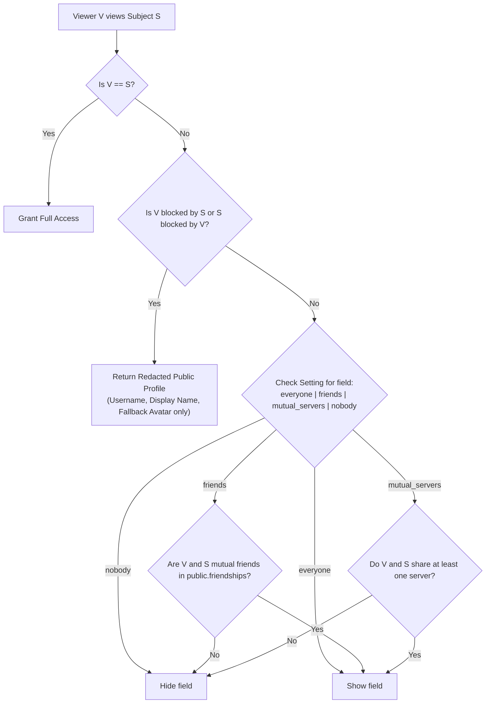
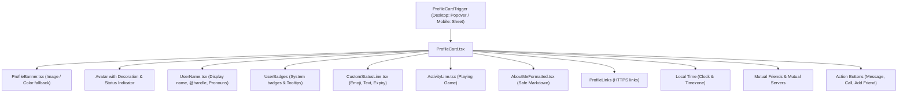

# Nexus Profile Customization & Privacy Architecture

This document specifies the technical design, database schema, security model, media pipeline, and component hierarchy for the Profile Customization and Database-Enforced Privacy system introduced in Migration `00038_profile_customization_and_privacy.sql`.

---

## 1. System Overview

Nexus user profiles provide identity customization across both global and per-server contexts while maintaining privacy, safety, and performance:
- **Privacy First**: Visibility of bio, status, presence, activities, badges, and local time is enforced at the PostgreSQL database level via Row Level Security (RLS) and `SECURITY DEFINER` RPC functions—never deferred to client code alone.
- **Audience Granularity**: Four-tier visibility resolution (`everyone`, `friends`, `mutual_servers`, `nobody`) with automatic blocking overrides.
- **Server Identity Independence**: Server members can override their global nickname, avatar, banner, bio, and pronouns within any server they belong to without altering their global identity.
- **Zero-EXIF Media Pipeline**: Avatars and banners are cropped and re-encoded client-side to WebP format, stripping camera EXIF metadata prior to storage.
- **Universal Interactive Cards**: Clicking or focusing any user mention, message avatar, voice tile, or member row opens a lazy-loaded `ProfileCard` (Radix Popover on desktop, bottom sheet on mobile).

---

## 2. Database Schema & Migration 00038

Migration `00038_profile_customization_and_privacy.sql` establishes strict relational schemas, check constraints, and integrity triggers.

### 2.1 Core Schema Extensions

#### Table: `public.profiles`
| Column | Type | Constraints / Defaults | Description |
|---|---|---|---|
| `pronouns` | `VARCHAR(40)` | `CHECK (pronouns IS NULL OR length(trim(pronouns)) <= 40)` | Preferred pronouns |
| `bio` | `TEXT` | `CHECK (bio IS NULL OR length(bio) <= 500)` | Markdown-supported About Me |
| `custom_status` | `VARCHAR(128)` | `CHECK (custom_status IS NULL OR length(custom_status) <= 128)` | Status text |
| `custom_status_emoji` | `VARCHAR(16)` | `CHECK (custom_status_emoji IS NULL OR length(custom_status_emoji) <= 16)` | Status emoji |
| `custom_status_expires_at` | `TIMESTAMPTZ` | Default `NULL` | Automatic status expiry |
| `timezone` | `VARCHAR(64)` | Default `'UTC'` | User IANA timezone identifier |
| `banner_color` | `VARCHAR(7)` | `CHECK (banner_color ~* '^#[0-9a-f]{6}$')` | Dominant hex color for banner fallback |
| `accent_color` | `VARCHAR(7)` | `CHECK (accent_color ~* '^#[0-9a-f]{6}$')` | Theme accent color |
| `avatar_color` | `VARCHAR(7)` | `CHECK (avatar_color ~* '^#[0-9a-f]{6}$')` | Dominant color extracted from avatar |
| `avatar_path` | `TEXT` | `CHECK (avatar_path IS NULL OR avatar_path ~* '^[a-z0-9_-]+/')` | Supabase storage bucket relative path |
| `banner_path` | `TEXT` | `CHECK (banner_path IS NULL OR banner_path ~* '^[a-z0-9_-]+/')` | Supabase storage bucket relative path |
| `username_changed_at` | `TIMESTAMPTZ` | Default `NULL` | Last username modification timestamp |
| `favorite_games` | `JSONB` | Default `'[]'::jsonb` | Array of up to 6 favorite game titles |
| `activity_text` | `VARCHAR(128)` | Default `NULL` | Rich presence activity line |
| `activity_expires_at` | `TIMESTAMPTZ` | Default `NULL` | Expiry timestamp for rich presence |
| `voice_intro_path` | `TEXT` | Default `NULL` | Audio clip path for voice channel entry |

#### Table: `public.server_members`
Per-server identity overrides:
| Column | Type | Constraints / Defaults |
|---|---|---|
| `nickname` | `VARCHAR(32)` | `CHECK (nickname IS NULL OR length(trim(nickname)) <= 32)` |
| `avatar_path` | `TEXT` | Per-server avatar storage path |
| `banner_path` | `TEXT` | Per-server banner storage path |
| `bio` | `TEXT` | `CHECK (bio IS NULL OR length(bio) <= 190)` |
| `pronouns` | `VARCHAR(40)` | `CHECK (pronouns IS NULL OR length(trim(pronouns)) <= 40)` |
| `hide_server_avatar` | `BOOLEAN` | Default `FALSE` |
| `hide_server_banner` | `BOOLEAN` | Default `FALSE` |

#### Supplementary Tables
- **`public.profile_links`**: Stores up to 5 user links. A trigger (`trg_enforce_profile_links_limit`) strictly aborts if a user attempts to insert more than 5 rows. URLs are constrained to HTTPS.
- **`public.badges` & `public.user_badges`**: System-granted badges (e.g., `verified`, `early_supporter`, `moderator`, `bug_hunter`). RLS permits user `SELECT` but restricts `INSERT`/`UPDATE` to database service operations.
- **`public.profile_decorations`**: Available avatar rings and seasonal ornaments.
- **`public.username_history`**: Audit trail of historical usernames recording `old_username`, `new_username`, and `changed_at`.

### 2.2 Database Integrity Triggers

1. **Immutable Columns**:
   ```sql
   CREATE OR REPLACE FUNCTION public.enforce_profile_immutability()
   RETURNS TRIGGER AS $$
   BEGIN
     IF NEW.id <> OLD.id THEN
       RAISE EXCEPTION 'Profile ID is immutable';
     END IF;
     IF NEW.created_at <> OLD.created_at THEN
       RAISE EXCEPTION 'Profile created_at timestamp is immutable';
     END IF;
     RETURN NEW;
   END;
   $$ LANGUAGE plpgsql;
   ```
2. **Username Validation & 30-Day Cooldown**:
   Triggers on `BEFORE UPDATE OF username ON public.profiles`:
   - Enforces length (3 to 30 characters) and allowed characters (`^[a-z0-9_.]+$`).
   - Blocks reserved names (`admin`, `administrator`, `nexus`, `system`, `support`, `official`, `moderator`).
   - Enforces a 30-day cooldown period (`NEW.username_changed_at < OLD.username_changed_at + INTERVAL '30 days'`).
   - Automatically archives the previous username in `public.username_history`.
3. **Storage Path Prefix Isolation**:
   Trigger `enforce_profile_storage_prefix()` verifies that any updated `avatar_path` or `banner_path` begins with `<user_id>/` to prevent cross-account file reference spoofing.

---

## 3. Privacy Model & Audience Resolution

### 3.1 Audience Hierarchy

Each user configures visibility in `public.user_settings`:
- `profile_visibility`: Controls About Me bio and custom links.
- `presence_visibility`: Controls online/idle/dnd status and custom status text.
- `activity_visibility`: Controls rich presence ("Playing ...") and favorite game chips.
- `local_time_visibility`: Controls timezone and local time display.
- `badges_visibility`: Controls display of non-system badges.

Every setting accepts one of four values:
```
'everyone' | 'friends' | 'mutual_servers' | 'nobody'
```

### 3.2 Evaluation Rules

When Viewer $V$ requests profile data for Subject $S$:


### 3.3 Database RPCs

Direct `SELECT * FROM public.profiles` is restricted by RLS to own profile, friends, and mutual server members. External consumers retrieve data through two `SECURITY DEFINER` procedures:

1. **`get_profile_card(p_user_id UUID, p_server_id UUID DEFAULT NULL)`**:
   Returns the complete resolved card data for viewing a user:
   - Resolves server identity overrides (nickname, server avatar, server banner, server bio) if `p_server_id` is supplied.
   - Evaluates audience settings against the viewer `auth.uid()`.
   - Strips expired custom statuses (`custom_status_expires_at <= NOW()`).
   - Retrieves public badges, active links, mutual friends count, and mutual servers list.
2. **`get_public_profiles(p_user_ids UUID[])`**:
   Batch-fetches lean public profiles (`id`, `username`, `display_name`, `avatar_url`, `avatar_color`, `accent_color`) with cached SWR support.

---

## 4. Media & Storage Pipeline

### 4.1 Client-Side Processing (`src/lib/images/profile-images.ts`)

To protect user privacy and optimize network transfer, image files are never uploaded directly as received:
1. **EXIF Stripping**: The original image is rendered onto an off-screen HTML5 `<canvas>` element. Drawing pixel buffers to a fresh canvas discards all metadata, including camera serial numbers, GPS coordinates, and capture dates.
2. **Interactive 2D Crop**: `ImageCropDialog.tsx` allows panning and zooming. Circular masks are used for avatars (1:1 aspect ratio), and rectangular masks are used for banners (3:1 aspect ratio).
3. **WebP Re-Encoding**:
   - Avatars are exported to `image/webp` at `0.85` quality and verified $\le 2\,\text{MB}$.
   - Banners are exported to `image/webp` at `0.85` quality and verified $\le 3\,\text{MB}$.
4. **Dominant Color Extraction**:
   `extractDominantColor(file)` samples pixels from a 32x32 thumbnail to extract the dominant hex color code (`#RRGGBB`).
5. **Contrast Guarding**:
   `getContrastRatio(hex1, hex2)` ensures WCAG 2.1 AA compliance ($\ge 4.5:1$). If contrast against pure white is insufficient, the UI automatically adapts to dark foreground tokens.

### 4.2 Sized CDN Transformation (`resolveProfileImageUrl`)

Image URLs are dynamically rewritten with Supabase Image Transformations:
```
https://<project>.supabase.co/storage/v1/render/image/public/<bucket>/<path>?width=<w>&height=<h>&resize=cover&format=webp&quality=80
```
This ensures high-density (retina 2x) rendering without downloading full-resolution source assets.

---

## 5. Client Component Architecture



### 5.1 Store & Caching (`src/lib/profiles/profile-store.ts`)

`ProfileStore` maintains an in-memory stale-while-revalidate (SWR) cache (TTL: 60 seconds) with debounced batching:
- Multiple components requesting user profiles within a 16ms window have their IDs coalesced into a single `get_public_profiles` RPC call.
- Broadcast updates over Supabase Realtime automatically invalidate cached entries and notify subscribing UI components.

### 5.2 Settings Redesign (`ProfileTab.tsx`)

`ProfileTab.tsx` is organized into three distinct sub-sections:
1. **User Profile**: Global identity editing, avatar & banner cropping, bio, pronouns, accent color picker, and links manager.
2. **Server Profiles**: Dropdown server selector to preview and override per-server nickname, avatar, banner, bio, and pronouns.
3. **Privacy & Visibility**: Granular 4-tier audience controls for profile sections.
4. **Live Multi-State Preview**: Displays real-time rendering of the profile card, a simulated chat message, and a member list row. Includes a perspective selector ("View as Friend", "View as Stranger", "View as Server Member") and a Light/Dark preview toggle.

---

## 6. Accessibility & Design Compliance

- **Semantic HTML & Radix Primitives**: Dropdowns, dialogs, popovers, and sheets utilize Radix UI with full ARIA attributes (`role="dialog"`, `aria-label`, `aria-expanded`).
- **Keyboard Trapping**: Modals trap focus; pressing `Escape` dismisses the popover/dialog and returns focus to the trigger.
- **Contrast Ratios**: All text tokens meet WCAG 2.1 AA requirements ($\ge 4.5:1$ for body text, $\ge 3:1$ for large text).
- **Neutral Tone**: User-facing copy adheres to neutral design system standards (eliminated legacy phrasing such as "Gamer Tag" or "Battle Station").

